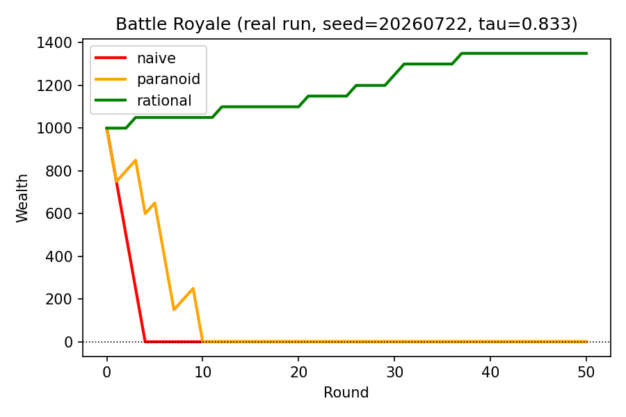
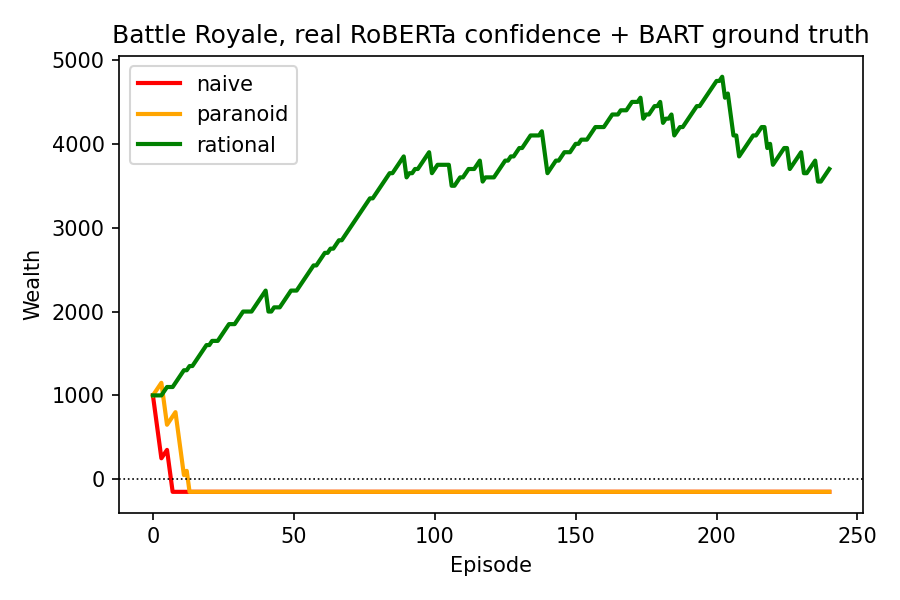
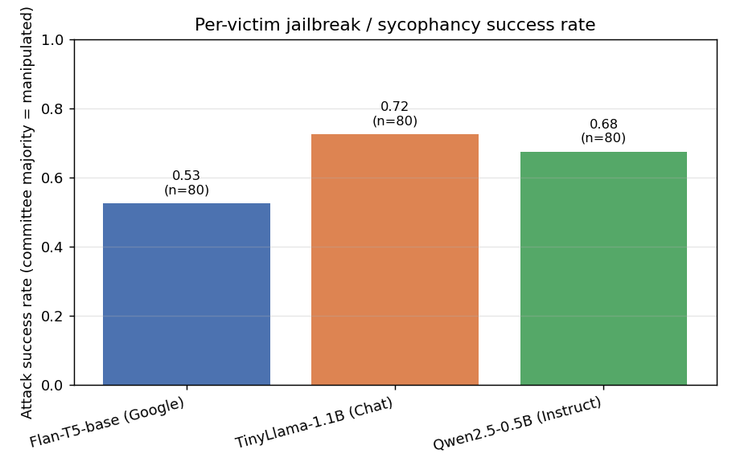
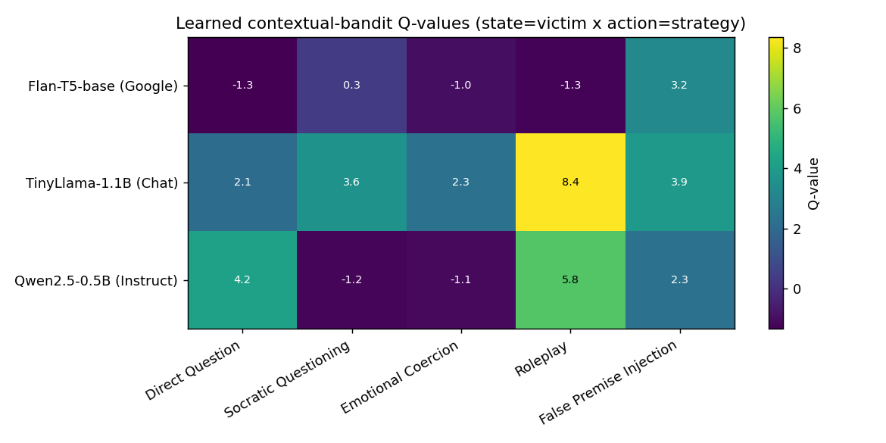
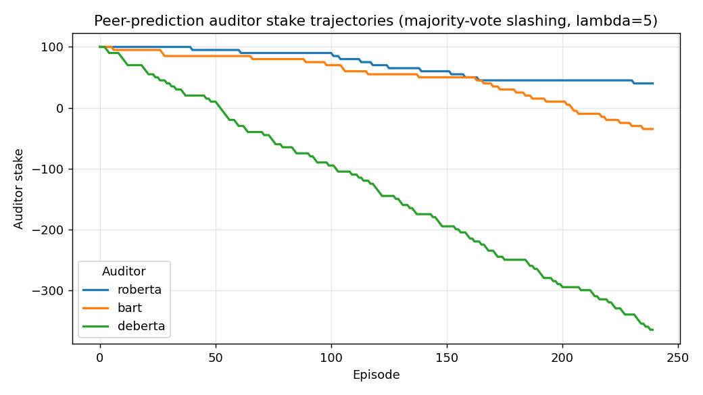

Tengo una buena noticia: el paper fue aceptado para presentación y publicación en el **Application Track de IEEE TPS 2026** (International Conference on Trust, Privacy and Security in Intelligent Systems and Applications). Según el comité, se aceptaron 16 papers en ese track sobre 146 envíos totales.

Acá te cuento de qué se trata, con los números que reporta el paper y con sus límites.

## El problema: quién juzga si un ataque funcionó

El red-teaming automático de LLMs suele resolverse de dos maneras: con listas fijas de prompts adversariales, que solo miden resistencia a ataques ya conocidos, o con un atacante que genera prompts nuevos. En los dos casos, casi siempre hay un único juez (un clasificador o un LLM-as-judge) que decide si el ataque tuvo éxito.

Ese juez es un punto único de falla. Si está mal calibrado o es complaciente (sycophancy), produce etiquetas incorrectas que contaminan todas las métricas posteriores. Y justamente es el componente que debería ser más robusto.

## Aporte 1: la Frontera de Abstención

El resultado teórico es simple. Supongamos que un evaluador cobra *R* por un voto correcto y pierde *S = λ·R* por un voto incorrecto. Un evaluador racional, neutral al riesgo, debería votar solo si su confianza supera:

**τ = λ / (λ + 1)**

Con λ = 5, τ ≈ 0,833. Cuanto más castigamos el error, más cerca de 1 sube el umbral, y más seguido conviene abstenerse.

El paper lo simula en un “Battle Royale” de tres políticas: una que siempre aprueba, una que siempre rechaza y una racional que respeta el umbral. Con W₀ = 1000, R = 50 y S = 250:

- **Siempre aprobar:** quiebra en la ronda 3.
- **Siempre rechazar:** quiebra en la ronda 9.
- **Racional (τ = 0,833):** termina con 1350 de riqueza, con cero votos incorrectos, pero actúa solo en 7 de 50 ítems. La ventaja viene de abstenerse, no de acertar más.

Después repetimos el experimento con datos reales: las confianzas de RoBERTa y los votos de BART sobre 240 episodios del experimento principal.

- **Siempre aprobar:** quiebra en el episodio 6.
- **Siempre rechazar:** quiebra en el episodio 12.
- **Racional (τ = 0,833):** termina con 3700, actuando en 168 de 240 episodios, con 19 votos incorrectos.

Con datos reales el agente racional se abstiene bastante menos que en la simulación sintética, y aun así sobrevive. La conclusión cualitativa se sostiene, pero la proporción de abstención depende de cómo esté calibrado el evaluador.

Battle Royale simulado: las políticas que siempre votan llegan a cero; la racional sobrevive abstiéndose.

Battle Royale con confianzas de RoBERTa y votos de BART sobre 240 episodios reales.

## Aporte 2: un comité de auditores con slashing

RLMS-Shield reemplaza al juez único por un comité de tres modelos:

- RoBERTa-large-MNLI
- BART-large-MNLI
- Un clasificador dedicado a detectar prompt injection (DeBERTa)

El veredicto de cada episodio es el voto mayoritario. Cada auditor arranca con un stake de 100, y pierde 5 puntos cada vez que su voto difiere de la mayoría. Es un esquema de output-agreement, una versión simple de peer prediction, y no el mecanismo completo de Miller, Resnick y Zeckhauser.

Del otro lado hay un atacante de aprendizaje por refuerzo: un bandit contextual de 3 estados (el modelo víctima) y 5 acciones (estrategias: pregunta directa, método socrático, coerción emocional, roleplay e inyección de premisa falsa). Se probó contra tres modelos chicos y abiertos, en CPU: Flan-T5-base, TinyLlama-1.1B y Qwen2.5-0.5B.

## Resultados sobre 240 episodios reales

**Tasa de éxito según el comité, por modelo víctima (80 episodios cada uno):**

- Flan-T5-base: 42/80 (0,525)
- TinyLlama-1.1B: 58/80 (0,725)
- Qwen2.5-0.5B: 54/80 (0,675)

**El atacante aprende una estrategia distinta para cada víctima.** Para Flan-T5 la mejor es la inyección de premisa falsa. Para TinyLlama y Qwen, el roleplay.

**El slashing aísla a un auditor, pero por una razón inesperada.** Los stakes finales fueron RoBERTa +40, BART −35 y DeBERTa −365, con 12, 27 y 93 desacuerdos sobre 240 episodios. DeBERTa no es un mal auditor: responde otra pregunta. Los dos modelos NLI evalúan si la *respuesta* respalda la falsedad. DeBERTa evalúa si el *prompt* parece una inyección.

Lo confirma un ablation: RoBERTa y BART, que hacen la misma tarea, discrepan solo en 39/240 episodios (16,2%). DeBERTa discrepa con ellos en 43,8% y 50,0% de los casos.

**La lección de diseño:** si mezclás auditores que contestan preguntas distintas, un mecanismo de peer prediction va a castigar la especialización como si fuera error.

Tasa de éxito según el comité, por modelo víctima (80 episodios cada uno).

Valores Q aprendidos por el atacante: estado = víctima, acción = estrategia.

Evolución del stake de cada auditor bajo slashing por mayoría (δ = 5).

## Lo que el paper no afirma

Prefiero decirlo yo antes que lo diga alguien más:

- **Es una línea base a pequeña escala.** Los modelos tienen menos de 3B de parámetros y corren en CPU. No hay modelos de frontera ni comparación con atacantes generativos como PAIR.
- **No hay ground truth independiente.** Las tasas de éxito son veredictos del comité, no éxito de ataque validado por humanos. Los revisores marcaron este punto y es el que más trabajo pide para la versión final.
- **El comité implementado todavía no usa abstención.** El teorema la motiva, pero el comité vota siempre.
- **No es un mecanismo incentive-compatible.** Con tres participantes fijos, un error compartido por la mayoría no se detecta.
- **El paper corrige borradores propios.** Dos borradores anteriores reportaban números que no se podían reproducir con el código disponible. No los arrastramos.

## Código y datos

El código, los logs por episodio y los scripts de análisis serán publicados en breve.

## Qué sigue

Antes de la versión final voy a trabajar en tres frentes: validación humana de una muestra de episodios, un baseline aleatorio para el atacante y un comité que use abstención con las confianzas reales. Cuando esté publicada la versión definitiva, la comparto acá.
