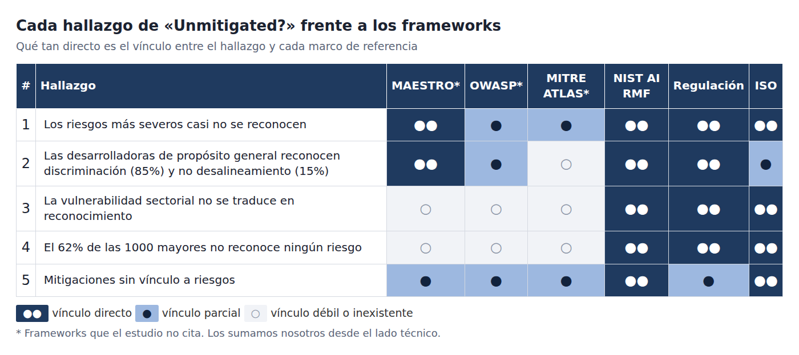
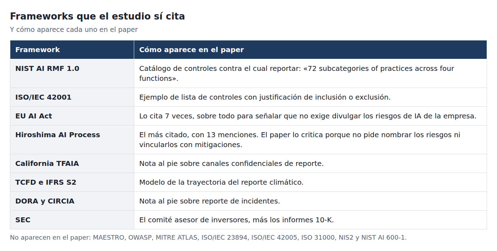

El MIT FutureTech leyó los documentos públicos de 200 de las mayores empresas del mundo y registró cuáles de 24 riesgos de IA reconocen. Después comparó esa lista con lo que opinan 272 expertos sobre los mismos riesgos. El estudio se llama *Unmitigated? How are the world's largest companies responding to AI risks?* (Saeri et al.) y tiene un dato que conviene tener presente: mide lo que las empresas dicen en público, no lo que hacen puertas adentro.

Con esa salvedad, los resultados incomodan. Los repaso uno por uno y a cada uno le pongo al lado los frameworks que ayudan a leerlo. Esta tabla resume qué tan directo es cada vínculo:

## Cinco hallazgos y los frameworks que los explican

**1. Los riesgos que los expertos consideran más graves casi no se nombran.** Entre las 100 mayores, ninguna reconoció centralización de poder, dinámicas competitivas, pérdida de realidad consensuada ni bienestar de la IA. Solo el 4% mencionó capacidades peligrosas y el 2%, desalineamiento. La correlación entre severidad y reconocimiento es de −0,16, con un intervalo amplio (−0,54 a 0,28), así que no es concluyente.
*Frameworks:* MAESTRO\* modela justo estos riesgos en su capa 1 (modelos de base) y su capa 7 (ecosistema de agentes). En NIST AI RMF corresponden a MAP y MEASURE, y el perfil de IA generativa NIST AI 600-1\* es el más cercano a "capacidades peligrosas". La EU AI Act (art. 55) obliga a los proveedores de modelos de propósito general con riesgo sistémico a hacer pruebas adversariales documentadas y a mitigar esos riesgos. Desde ISO, aplican ISO/IEC 42001 (cláusula 6.1) e ISO/IEC 23894\*.

**2. Las desarrolladoras de IA de propósito general reconocen discriminación (11 de 13) y casi no reconocen desalineamiento (15%).** Son los actores que los expertos señalan como más responsables de esos riesgos, y el estudio no encontró relación entre ser el responsable de un riesgo y reconocerlo.
*Frameworks:* en NIST AI RMF es un problema de GOVERN (roles y responsabilidades). MEASURE 2.11 respalda las pruebas de equidad que sí reportan, pero el alineamiento no tiene una subcategoría propia. La AI Act separa dos niveles: el art. 53 vale para todos los proveedores de modelos de propósito general y el art. 55 solo para los de riesgo sistémico. OWASP\* cubre parcialmente el riesgo que sí reconocen (LLM09, desinformación). MITRE ATLAS\* no aplica: describe adversarios, y el desalineamiento no necesita uno.

**3. Estar muy expuesto no alcanza.** Cada punto más de vulnerabilidad sectorial sube 7,4 puntos porcentuales la probabilidad de reconocer un riesgo, pero el 77% de los riesgos no fue reconocido por empresas de sectores "extremadamente vulnerables" a ellos.
*Frameworks:* NIST AI RMF lo trata en MAP 1 (contexto de uso) y MAP 5 (probabilidad y magnitud de impactos). La AI Act regula por uso de alto riesgo (anexo III), no por sector, y esas reglas rigen desde diciembre de 2027. El estudio cita además DORA, que exige reportar incidentes TIC a los reguladores financieros, y toma de IFRS S2 la idea de guías sectoriales. ISO/IEC 42001 pide entender el contexto de la organización y sus partes interesadas.

**4. El 32% de las 100 mayores no reconoció ningún riesgo de IA.** Para las 1000 mayores se estima 62% (IC 95%: 54–70%), una extrapolación a partir de 200 empresas.
*Frameworks:* es el hallazgo más ligado a normativa. NIST AI RMF lo cubre con GOVERN 4.2 (documentar y comunicar riesgos e impactos). La AI Act (art. 50) obliga a informar a las personas que interactúan con un sistema de IA, pero no exige divulgar públicamente los riesgos de la empresa, y el estudio lo marca como laguna. El precedente que propone es TCFD → IFRS S2 en clima: en el Reino Unido el reporte obligatorio de emisiones redujo emisiones cerca de 8%. ISO/IEC 42001 permite certificar un sistema de gestión, una señal verificable por terceros.

**5. El 71% reporta alguna mitigación, pero casi ninguna la vincula con un riesgo concreto.** Desde afuera no se distingue a una empresa que gestiona bien y no lo cuenta de una que no gestiona.
*Frameworks:* es el que más frameworks tiene a favor, porque todos usan el formato riesgo → control. NIST AI RMF lo cubre con MANAGE 1.2 (priorizar el tratamiento de riesgos documentados) y MANAGE 4.3 (comunicar incidentes). MAESTRO\* propone mitigaciones por capa y amenaza. Cada categoría de OWASP\* viene con sus mitigaciones, y MITRE ATLAS\* asocia técnicas con mitigaciones. ISO/IEC 42001 exige una Declaración de Aplicabilidad que justifica cada control incluido o excluido, y el estudio la propone como modelo de reporte. La AI Act pide gestión de riesgos continua (art. 9) y reporte de incidentes graves (art. 73), pero solo para sistemas de alto riesgo.

Para citar con precisión, conviene saber cuáles de estos frameworks aparecen en el estudio y cómo:

*\* Estos frameworks no aparecen en el estudio. Los sumamos nosotros desde el lado técnico, así que no se los atribuyas a los autores. NIST AI RMF, ISO/IEC 42001, la AI Act, el Hiroshima AI Process, TCFD/IFRS S2, DORA y la SEC sí están citados por el paper.*

**Lectura transversal:** los hallazgos 3, 4 y 5 hablan de lo que se dice en público, y ahí pesan NIST AI RMF, ISO/IEC 42001 y la regulación. Los hallazgos 1 y 2 son de riesgos técnicos y de ecosistema, y ahí ayudan más MAESTRO y NIST 600-1. OWASP y MITRE ATLAS sirven para ilustrar qué amenazas concretas quedan sin nombrar, no para medir divulgación.

## Explorarlo vos mismo

El MIT publicó los datos en un explorador: [airisk.mit.edu/company-disclosures](https://airisk.mit.edu/company-disclosures). Podés buscar una empresa y ver qué riesgos reconoce, con los pasajes citados de sus propios documentos. También permite comparar sectores y recorrer cada riesgo. Si trabajás en una empresa grande, buscá la tuya. Es un ejercicio revelador.

## Y el arquitecto, ¿qué hace con esto?

Si la brecha es que las empresas no conectan riesgo con control, quien diseña el sistema puede cerrarla. Por eso escribimos **[Seguridad y gobernanza en arquitectura de IA agéntica](https://claude.ai/artifact/GKsSKXSEqCt3WYDeEyPxNh)**, un informe sobre qué debe saber un arquitecto. Es la pieza que quiero destacar.

Algunas ideas del informe:

- **Seguridad y gobernanza son estructura, no un filtro al final.** Un agente que ejecuta herramientas en producción sin supervisión continua exige diseñar desde el principio los límites de acción, la identidad con menor privilegio por agente y las políticas como código (por ejemplo OPA/Rego evaluando cada llamada a una herramienta).
- **Lo que no se registra no se puede auditar.** Trazabilidad de decisiones, snapshots de la base de conocimiento y logs inmutables son requisitos de cumplimiento y de análisis forense.
- **Cada rol decide una parte.** El CISO define la política, Legal clasifica el riesgo, Riesgo fija la pérdida tolerable, Auditoría pide la evidencia. El arquitecto diseña el mecanismo que los hace cumplir.
- **La matriz de amenazas es el antídoto contra el hallazgo 5.** Cada fila une un componente afectado, un vector (OWASP, MITRE ATLAS), un escenario, el impacto y el **control arquitectónico que lo mitiga**, y suma quién es responsable y qué evidencia demuestra que el control funciona. Ese es el vínculo riesgo → control que el estudio no encontró en los reportes públicos.
- **El momento importa.** Tiene sección propia: modelado de amenazas en el diseño, pruebas adversarias (garak, PyRIT, promptfoo) y una puerta de calidad en el CI/CD, y monitoreo, red teaming y respuesta a incidentes en operación. Cada fase queda asociada a funciones del NIST AI RMF y a la evidencia que deja.

Una aclaración honesta: este informe no sale del estudio del MIT. Es una guía de práctica para arquitectos. Lo que los une es la pregunta de fondo. El estudio muestra que, desde afuera, "tomamos medidas" no se puede verificar. El informe describe cómo construir un sistema donde sí se pueda.

## Para llevarse

- Mirá el explorador y buscá a la empresa donde trabajás o a la que le comprás.
- Si diseñás agentes, empezá por la matriz de amenazas y exigí que cada riesgo tenga un control con nombre.
- Recordá lo que el estudio no mide: puede haber empresas que gestionan bien y lo callan. La brecha es de transparencia, y eso también es un problema.

*Fuentes: Saeri et al., MIT FutureTech, "Unmitigated? How are the world's largest companies responding to AI risks?"; explorador en airisk.mit.edu/company-disclosures.*
