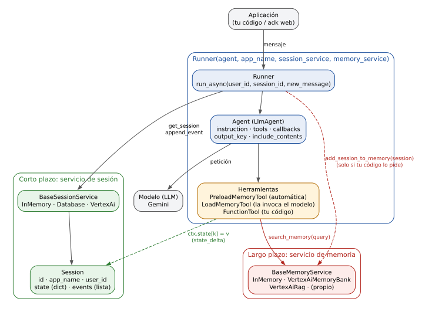
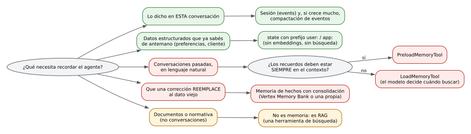

Cuando alguien dice «mi agente tiene memoria», puede estar hablando de cuatro cosas diferentes. En el Agent Development Kit (ADK) de Google esas cuatro cosas conviven, se comportan distinto y se rompen de maneras distintas. Confundirlas es la fuente más común de errores al diseñar agentes con memoria.

Revisé el código de ADK 2.10.0 para escribir un informe técnico sobre el tema, y para este post volví a comprobar los puntos clave en la 2.13.0. Al final cuento qué verifiqué y qué no.

## Las cuatro capas

| Capa | Qué es | Cuánto dura | Quién la lee |
|---|---|---|---|
| **Contexto** | Lo que el modelo recibe en una sola llamada | Una llamada | El modelo |
| **Historial** (`events`) | Lista cronológica de mensajes, llamadas a herramientas y respuestas | La sesión | El modelo, por defecto |
| **Estado** (`state`) | Diccionario de pares clave-valor asociado a la sesión | La sesión (o más, con prefijos) | **El código, no el modelo** |
| **Memoria de largo plazo** | Servicio externo (`BaseMemoryService`) indexado por `(app_name, user_id)` | Entre conversaciones | El modelo, mediada por herramientas |

Las dos del medio responden a «qué pasó en esta conversación». La última responde a «qué sabemos de este usuario a partir de conversaciones anteriores». Y el contexto es el resultado de decidir qué de todo lo anterior entra en cada llamada.



### El estado no es una extensión del historial

El detalle que más se pasa por alto: **el modelo no lee el estado.** Solo le llega si una plantilla `{variable}` en la instrucción lo incorpora o si una herramienta lo devuelve. Que el modelo «sepa» algo porque aparece en el historial no significa que esté en el estado. Son dos almacenes con dos lectores distintos.

El prefijo de la clave decide a quién pertenece cada valor:

- **sin prefijo** → esa sesión;
- **`user:`** → todas las sesiones del mismo usuario en la aplicación;
- **`app:`** → todos los usuarios de la aplicación;
- **`temp:`** → solo la invocación en curso, y no se persiste.

Esto tiene una consecuencia valiosa: las claves `user:` son **una forma de memoria entre sesiones sin embeddings ni búsqueda**. Para datos que ya conocés de antemano (preferencias, idioma, datos del cliente) es más barata, más determinista y más auditable que cualquier servicio de memoria.

```python
def registrar_dato(campo: str, valor: str, tool_context: ToolContext) -> dict:
    tool_context.state[campo] = valor              # se convierte en state_delta
    tool_context.state["user:ultimo_campo"] = campo
    return {"ok": True}
```

La documentación oficial pide no modificar `session.state` directamente fuera de estos caminos: se saltea el historial de eventos, se rompe la persistencia y aparecen problemas de concurrencia.

## Dos hechos de diseño que lo condicionan todo

### 1. ADK no guarda la sesión en la memoria por sí solo

El flujo del `Runner` no contiene ninguna llamada automática a `add_session_to_memory`. La ingesta ocurre porque tu código la pide. El patrón recomendado es un callback:

```python
async def guardar_sesion(callback_context):
    await callback_context.add_session_to_memory()

agente = Agent(name="a", model="...", after_agent_callback=guardar_sesion)
```

Elegir cuándo guardar es una decisión con consecuencias. Guardar la sesión completa al cerrarla es simple, pero deja la información fuera de alcance hasta que termina. Guardar un delta de eventos al final de cada turno (`add_events_to_memory`) la pone disponible antes y evita reprocesar, pero multiplica las escrituras. Escribir entradas ya elaboradas (`add_memory`) te da control total sobre qué se recuerda, a costa de que tu código decida qué es importante.

### 2. Recuperar no es lo mismo que mostrar

`search_memory` devuelve datos *al código*. Para que el modelo los vea hace falta una herramienta o un callback:

- **`PreloadMemoryTool`** consulta la memoria automáticamente antes de cada llamada al modelo, usando el texto del mensaje del usuario como consulta, y agrega los recuerdos como un contenido de usuario transitorio, sin guardarlo en el historial. El modelo nunca la ve como función. Si `search_memory` falla, la herramienta no propaga el error: registra una advertencia y sigue sin memoria. Es buena para la disponibilidad y mala si nadie mira los logs.
- **`LoadMemoryTool`** expone `load_memory(query)` al modelo, que decide si busca y con qué consulta. Cada búsqueda cuesta una vuelta más del bucle, y el riesgo es que el modelo **no busque**.
- **Una herramienta propia** sirve cuando la consulta literal del usuario es un mal criterio de búsqueda (un seguimiento como «¿y el otro?» no recupera nada útil) y querés reformularla, filtrar o combinar resultados.

Como el preprocesamiento corre en cada paso del bucle, `PreloadMemoryTool` consulta la memoria en cada llamada al modelo dentro de la misma invocación *(inferido)*. Un servicio caro multiplica su costo por las vueltas.

## Tres servicios incluidos

| | `InMemoryMemoryService` | `VertexAiMemoryBankService` | `VertexAiRagMemoryService` |
|---|---|---|---|
| **Qué guarda** | Eventos originales | Hechos extraídos y consolidados | Transcripciones en un corpus |
| **Búsqueda** | Palabras en común (máx. 10 resultados) | Similitud semántica | Similitud vectorial |
| **Embeddings** | No | Sí, internos al servicio | Sí, internos al corpus |
| **Escritura** | Síncrona, en RAM | Asíncrona por defecto | Subida de archivo |
| **Persistencia** | No | Sí | Sí |
| **Mejor uso** | Prototipos y pruebas | Hechos del usuario que evolucionan | Transcripciones sobre una infraestructura RAG existente |

Desde la línea de comandos se elige con `--memory_service_uri` (`memory://`, `rag://` o `agentengine://`). Cuatro cosas que conviene saber:

- La ingesta de Memory Bank es una tarea en segundo plano: si consultás inmediatamente después de guardar, puede que no veas todavía lo nuevo (consistencia eventual).
- `search_memory` solo envía el texto de la consulta. Parámetros como `top_k` o filtros por metadatos no se exponen en esa interfaz.
- En el servicio basado en RAG, `vector_distance_threshold` vale 10 por defecto, que en la práctica no filtra nada. Si querés descartar resultados poco relevantes, tenés que fijarlo vos y calibrarlo contra tu modelo de embeddings.
- **El contrato no incluye borrar ni actualizar entradas.** El derecho al olvido hay que resolverlo en la implementación.

## La decisión que importa: dónde ponés el riesgo

Una memoria de **turnos crudos** guarda lo que se dijo, tal cual. Es simple y fiel, pero el riesgo se desplaza a la **lectura**: un dato guardado puede no llegar al modelo si no entra entre los `top_k` más parecidos a la consulta. Además, las correcciones se acumulan: si el usuario dijo «el plazo es de 24 meses» y después «no, es de 18», la memoria conserva ambos enunciados y el modelo tiene que decidir cuál vale.

Una memoria de **hechos consolidados** (la de Memory Bank) mantiene un único hecho vigente y conserva el anterior como historial. Resuelve las correcciones, pero desplaza el riesgo a la **escritura**: un hecho mal extraído se guarda como si fuera verdad.

Ninguna variante elimina el riesgo. El diseño consiste en elegir cuál estás dispuesto a gestionar.

| Diseño | Dónde falla | Cómo se mitiga |
|---|---|---|
| Turnos crudos | Lectura: el dato guardado no llega al modelo | `top_k` mayor, consultas más ricas, filtros, `LoadMemoryTool` |
| Hechos consolidados | Escritura: extracción incorrecta o corrección no detectada | Validar la salida, revisar umbrales, conservar el historial |
| `PreloadMemoryTool` | La consulta depende de las palabras del último mensaje | Combinarla con una herramienta de lectura propia |
| `LoadMemoryTool` | El modelo no busca | Instrucciones claras o precargar lo básico |

### Los embeddings capturan el tema, no la verdad

Si construís la consolidación vos, un patrón habitual es un **triaje en dos etapas** con embeddings. Para cada hecho nuevo se busca el hecho vigente más cercano del mismo usuario. Si la similitud supera un umbral alto, es un duplicado y se descarta sin llamar al modelo. Si queda por debajo de uno bajo, es un tema distinto y se agrega sin llamar al modelo. Solo en la zona intermedia (mismo tema, contenido distinto, que es donde viven las correcciones) se le pide a un modelo que decida entre actualizar, agregar o ignorar. El código valida esa respuesta. El modelo propone y desempata, y el código decide.

Dos advertencias sobre ese esquema:

- «24 meses» y «18 meses» producen vectores muy parecidos, porque el embedding captura el tema y no el valor. Con un umbral alto mal calibrado, una corrección se convierte en un «duplicado» y se pierde en silencio.
- Un embedding no entiende negaciones: «el cliente aprobó el crédito» y «el cliente no aprobó el crédito» quedan muy cerca. Por eso la zona intermedia se le confía a un modelo generativo y no a un tercer umbral.

Los umbrales dependen del modelo de embeddings y del idioma, así que hay que medirlos con datos propios.

## Cómo elegir: empezá por lo más simple



De menos a más complejo:

1. **Solo sesión.** Una conversación, sin memoria entre sesiones. Es el valor por defecto.
2. **Estado entre sesiones** con claves `user:` y `app:`. Barato, determinista y suficiente cuando los datos se conocen de antemano.
3. **Turnos crudos con búsqueda vectorial.** Simple, con riesgo en la lectura y acumulación de correcciones.
4. **Hechos consolidados.** Lectura limpia y manejo de correcciones, al precio de llamadas a un modelo al escribir.
5. **RAG sobre documentos.** No es memoria del usuario, pero suele combinarse con ella: la memoria dice quién es el usuario y qué se habló, y el RAG dice qué establece la normativa o la documentación.

En la práctica, el criterio que más decide entre 3 y 4 es una pregunta: **¿una corrección tiene que reemplazar al dato viejo?** Si los datos del usuario evolucionan (plazos, montos, preferencias) y el agente debe actuar sobre el valor vigente, con turnos crudos le estás pidiendo al modelo que reconcilie versiones contradictorias en cada respuesta, y eso no conviene delegarlo en algo tan variable como una generación.

## Checklist para producción

- **Aislamiento.** El contrato indexa por `(app_name, user_id)`, pero el cumplimiento es responsabilidad de la implementación. En una implementación propia, aplicá el filtro dentro de la consulta vectorial y no después. Probá siempre que otro `user_id` no recupere memoria ajena y que un usuario sin memoria reciba una lista vacía.
- **Retención y borrado.** Como el contrato no borra, resolvelo en el servicio. Memory Bank ofrece TTL y revisiones. Las consultas y pasajes que procesan los servicios de Vertex AI salen del proceso hacia Google Cloud: con datos sensibles, verificá antes la región, el acuerdo de procesamiento de datos y el control de acceso del destino. Los embeddings no son datos anónimos y merecen la misma política que el texto.
- **Consistencia.** Si un flujo necesita leer lo que acaba de escribir (alguien corrige un dato y pregunta enseguida), usá la ruta de generación con `wait_for_completion` o diseñá el flujo para tolerar la demora.
- **Costo y contexto.** Todo lo que devuelve `search_memory` entra en el contexto del modelo. Tratá `top_k` y los umbrales como parámetros de diseño y no como valores por defecto.
- **Observabilidad.** Distinguí lo que recuperó el servicio de lo que recibió el modelo: un `before_model_callback` que registre la petición muestra qué recuerdos llegaron de verdad. Y monitoreá las advertencias de `PreloadMemoryTool`, porque absorbe las excepciones.
- **Evaluación.** Evaluá la recuperación como un componente propio: armá pares consulta-memoria esperada y medí con qué frecuencia aparece la correcta entre los `k` resultados. En diseños con consolidación, medí también duplicados no detectados, correcciones perdidas y hechos mal extraídos, que son los errores que se acumulan sin hacer ruido.

## Qué verifiqué y qué no

- **Código de ADK 2.10.0:** contratos y firmas de `BaseMemoryService` y `Session`; los tres servicios incluidos; `PreloadMemoryTool` y `LoadMemoryTool`; los campos de `EventsCompactionConfig` y `MemoryEntry`; los métodos del `Context`.
- **Rechequeado en la 2.13.0 para este post:** el tope de 10 resultados de `InMemoryMemoryService`, el valor por defecto de 10 de `vector_distance_threshold`, los esquemas `memory://`, `rag://` y `agentengine://`, la inserción transitoria y la tolerancia a fallos de `PreloadMemoryTool`, y los cuatro métodos de memoria del `Context`.
- **No lo ejecuté contra la nube.** Lo que digo de Memory Bank (embeddings internos, TTL, revisiones, consolidación) sale de la documentación oficial. Tampoco verifiqué la compactación de eventos, ni el almacenamiento interno de `DatabaseSessionService` y `VertexAiSessionService`.
- Los umbrales de similitud dependen del modelo y del idioma. Las versiones nuevas de ADK pueden cambiar estos comportamientos: ante una actualización, revisá de nuevo `PreloadMemoryTool`, `InMemoryMemoryService` y los servicios de Vertex AI.

Fuentes: documentación de ADK sobre [sesiones y memoria](https://adk.dev/sessions/memory/) y [estado](https://adk.dev/sessions/state/), documentación de [Memory Bank en Google Cloud](https://docs.cloud.google.com/agent-builder/agent-engine/memory-bank/overview) y el código fuente de ADK.
