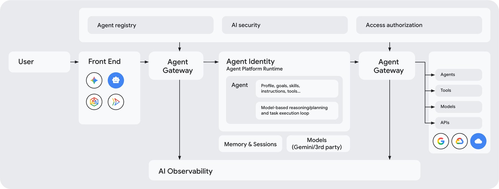
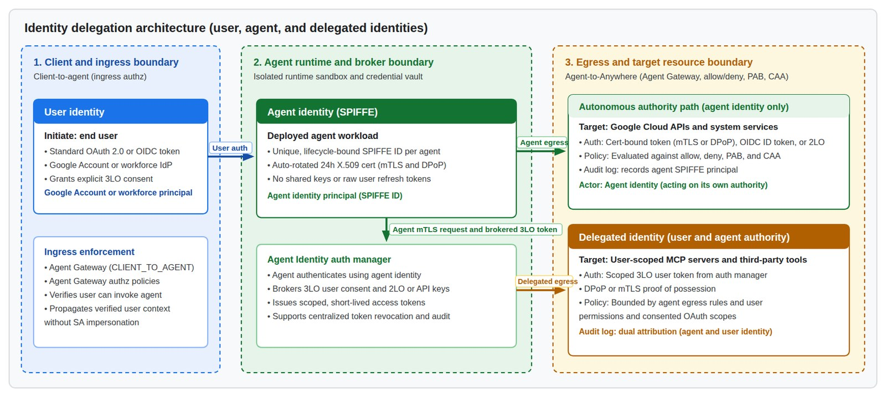
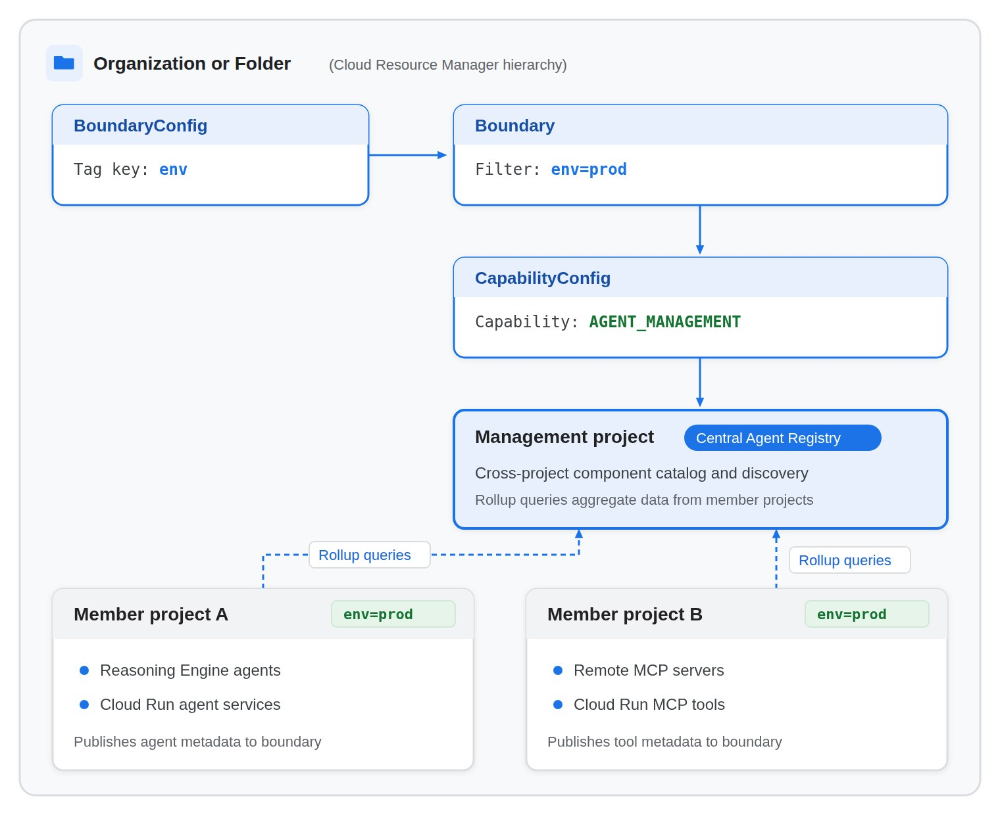
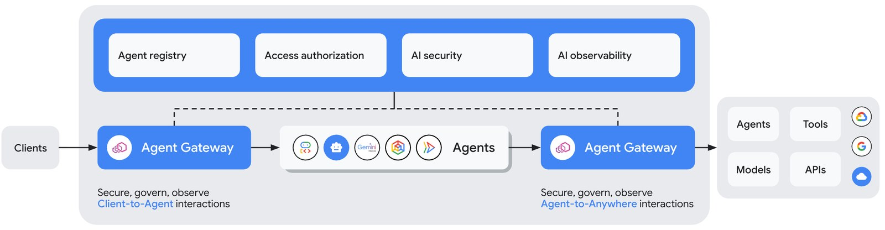
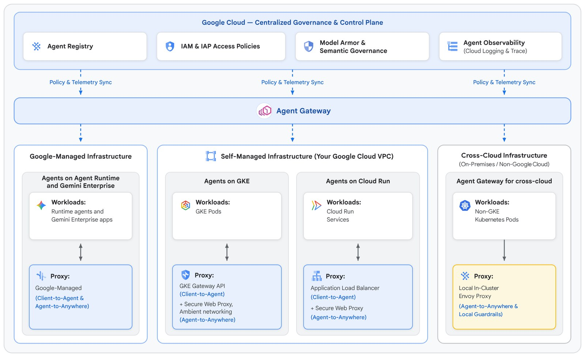
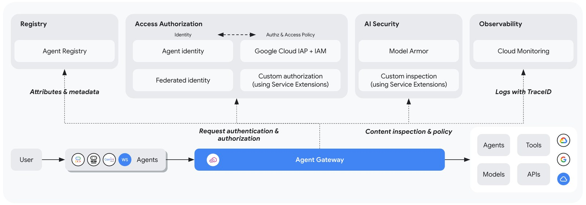

Gobernar agentes en una organización obliga a responder cinco preguntas: quién hace la solicitud, qué destinos están aprobados, qué acciones están permitidas, dónde se aplican las reglas y qué pasó. Gemini Enterprise Agent Platform reparte esas respuestas en piezas separadas. Este post resume las tres centrales: **Agent Identity**, **Agent Registry** y **Agent Gateway**.

Se basa en un informe técnico descriptivo que preparé el 08/11/2026 a partir de la documentación oficial. **No ejecuté nada en un proyecto real de Google Cloud**: lo que sigue es lo que dice la documentación, no una garantía de comportamiento.

> **Descargar el informe completo (PDF, 25 páginas):** [informe-gcp-agent-registry-identity-gateway.pdf](/assets/pdf/informe-gcp-agent-registry-identity-gateway.pdf)

Las figuras de este post provienen de la documentación de Google Cloud y cada pie indica su página de origen.

## El mapa: cinco piezas, cinco preguntas

| Pieza | Pregunta que responde | Qué es |
|---|---|---|
| **Agent Identity** | ¿Quién hace la solicitud? | Identidad criptográfica por agente (SPIFFE), con certificado X.509 de 24 horas |
| **Agent Registry** | ¿Qué destinos están aprobados? | Catálogo de agentes, servidores MCP, herramientas, endpoints y skills |
| **Policies** | ¿Qué acciones están permitidas? | Políticas de acceso IAM, Model Armor, gobernanza semántica, gestión de tokens |
| **Agent Gateway** | ¿Dónde se aplican? | Punto de entrada y salida de red del tráfico de los agentes |
| **Observability** | ¿Qué pasó? | Telemetría de red, logs y trazas |

Las tres piezas del informe se necesitan entre sí. La identidad hace que cada agente sea un *principal* que IAM puede nombrar. El registro da nombres de recurso estables a los destinos, que es a lo que apuntan las políticas. El gateway consulta identidad y registro antes de dejar pasar cada llamada y, **por defecto, bloquea todo lo que no tenga una regla explícita que lo permita**.

## 1. Agent Identity: quién es el agente

Cada agente recibe una identidad basada en el estándar SPIFFE, con la que se autentica ante servidores MCP, recursos de nube y otros agentes, por cuenta propia o en nombre de un usuario. A diferencia de una cuenta de servicio, según la documentación:

- no se comparte entre cargas de trabajo por defecto,
- no se puede suplantar,
- no permite claves de larga duración,
- emite tokens ligados criptográficamente al certificado X.509 único del agente, para impedir el robo de tokens.

La arquitectura separa **tres identidades** a lo largo de tres fronteras de confianza:

| Identidad | Quién es | Cómo se establece |
|---|---|---|
| De usuario | El usuario final que inicia la acción | OAuth 2.0 u OIDC |
| De agente | El agente actuando con autoridad propia | SPIFFE ID con certificado X.509 aprovisionado automáticamente |
| Delegada | El agente actuando por el usuario | Credenciales OAuth de tres patas con alcance limitado, intermediadas por el *auth manager* |

En el camino delegado, el registro de auditoría guarda **atribución doble**: el agente y el usuario.

Detalles que conviene tener presentes:

- **El agente es el principal.** Los permisos se otorgan directamente a su identificador, y en IAM se usa la forma `principal://` o `principalSet://`, no `spiffe://`.
- **La identidad nace del recurso.** Si se elimina el agente y se despliega un reemplazo con el mismo nombre, recibe un principal nuevo y los permisos anteriores no le aplican. Eliminar un agente tampoco borra los *bindings* de IAM que lo mencionan: quedan como concesiones inactivas y hay que retirarlas a mano.
- **Control de acceso por contexto** activo por defecto: mTLS entre el agente y la API o el gateway, y DPoP (RFC 9449) para el tramo posterior.
- **Controles asociados:** políticas de denegación en IAM, *Principal Access Boundary* (limita a qué recursos puede llegar el agente, sin importar sus demás permisos) y VPC Service Controls.

## 2. Agent Registry: qué componentes existen

El registro permite registrar, descubrir y gobernar agentes, servidores MCP, endpoints y skills en un solo lugar. Antes de enrutar una solicitud, el gateway lo consulta.

**Cuatro capas de identificación** que la documentación insiste en no mezclar:

| Capa | Propósito | Rol en la gobernanza |
|---|---|---|
| Identificadores de registro (URN) | Descubrimiento y búsqueda estables | Inmutables; **no** se usan para gobernar |
| Nombres de recurso | Identificar el destino | Lo que exigen las políticas, las rutas y los *bindings* de IAP |
| Principales de agente | Autenticación y autorización del llamante | Lo aplica IAM |
| Referencias de runtime | Enrutamiento físico del tráfico saliente | Se evalúan en el gateway |

**Registro automático y manual.** Agent Runtime, los agentes integrados de Google y los servidores MCP de Google se registran solos. GKE y Cloud Run requieren un opt-in por etiqueta o bandera. Lo que corre en otros lugares (on-premises, otras nubes) se registra a mano.

**Un cuidado práctico:** las banderas con que se crea un registro manual deciden qué recurso resulta. Pasar la bandera de agente al registrar un endpoint crea un *agente*, y las políticas por tipo no se aplican como se espera.

Para gobernar muchos proyectos, un proyecto de gestión central agrega los agentes y servidores MCP descubiertos en los proyectos miembros, agrupados por etiquetas. Esta capacidad figura como *Preview* en la documentación.

**Skills.** Las skills independientes siguen la especificación abierta Agent Skills y tienen ciclo de vida (borrador, activa, deshabilitada, deprecada, dada de baja), revisiones inmutables y escaneo de seguridad por defecto, que bloquea la promoción si encuentra exfiltración de datos, credenciales expuestas o inyección de prompts.

## 3. Agent Gateway: dónde se aplican las políticas

Es el punto de entrada y salida de red definido por software para todas las interacciones agénticas, con una postura de mínimo privilegio.

Tiene **dos rutas independientes**:

- **Client-to-Agent (ingreso):** autentica credenciales entrantes e inspecciona prompts.
- **Agent-to-Anywhere (egreso):** aplica la identidad de la carga de trabajo, el registro de destinos, las políticas IAM y la sanitización de contenido a lo que el agente envía hacia herramientas, servidores MCP, APIs y otros agentes.

Para MCP, el gateway inspecciona el JSON-RPC para extraer el método y el nombre de la herramienta, lo que permite **políticas finas por herramienta**.

### Cómo decide cada llamada de salida

1. **Interceptación.** El agente hace una llamada con su identidad y el gateway la intercepta.
2. **IAM y PAB.** Se verifica que una política conceda a la identidad del agente acceso de egreso al destino.
3. **Registro.** Se comprueba que el destino esté registrado. Si no, debe existir una política explícita sobre la URL. **Sin política que coincida, se deniega.**
4. **Contenido.** Si lo anterior pasa, se evalúan las barreras opcionales: Model Armor, gobernanza semántica o un motor de autorización propio.
5. **Reenvío** al destino.

Todo queda en los logs del gateway, en la auditoría y en la traza.

### Las políticas disponibles

| Política | Qué hace | Estado según la documentación |
|---|---|---|
| Políticas de acceso IAM | Reglas ALLOW/DENY por identidad, herramienta y destino, con condiciones en CEL. **El DENY prevalece** | Sin etiqueta de etapa |
| Model Armor | Filtros sobre prompts y respuestas (modos «solo inspeccionar» o «inspeccionar y bloquear») | Sin etiqueta de etapa |
| Gobernanza semántica | Restricciones en lenguaje natural evaluadas por un LLM | Preview |
| Gestión de tokens | Monitoreo y presupuestos compartidos | Próximamente |
| Motores de autorización propios | Delegar decisiones a terceros | Parcialmente «próximamente» |

**Recomendación de la documentación:** empezar en modo auditoría (registrar qué se habría bloqueado sin bloquear), revisar los logs y recién entonces pasar a aplicar las políticas. Una advertencia: al vincular un gateway en modo de aplicación, todo el tráfico saliente del agente pasa por él, incluida la API de sesiones. Sin una lista de endpoints esenciales permitidos, las invocaciones fallan.

## Tres hechos para tener presentes desde el principio

1. **El estado de lanzamiento del Agent Gateway no es consistente entre las páginas de la documentación.** Hasta confirmarlo en la consola, conviene tratarlo como *Preview*.
2. **El Agent Registry no tiene campo de responsable humano (`owner`) ni clasificación de datos.** Guarda tipo, URL, descripción, protocolo y capacidades, pero no atributos de gobernanza organizacional.
3. **El gateway está documentado hoy solo para Agent Runtime y Gemini Enterprise.** GKE, Cloud Run y entornos multinube figuran como «próximamente».

## Lo que la documentación no cubre

Es la parte que más me interesa desde la mirada de arquitectura:

- metadatos de gobernanza en el registro (responsable, clasificación de datos, nivel de autonomía, centro de costos),
- políticas deterministas sobre **argumentos**, montos y clasificación de datos (las condiciones CEL no los ven),
- estados del plano de control como suspender, poner en cuarentena o drenar un agente,
- un mecanismo documentado para «deshabilitar» una identidad (existen denegación en IAM, PAB, redespliegue y revocación de credenciales delegadas),
- detalles de cuotas, latencia por evaluación y regiones disponibles del gateway.

Si tu caso de uso necesita alguno de estos puntos, hay que resolverlo con diseño propio y no darlo por incluido.

## Qué es opinión y qué no

- El informe se escribió a partir del texto completo de la documentación oficial descargada el 08/11/2026. Es un producto en evolución y varias capacidades figuran como *Preview* o «próximamente», así que los detalles pueden haber cambiado.
- **Nada se ejecutó contra Google Cloud.** Una parte del informe se verificó leyendo código de ADK instalado en mi máquina, pero tampoco se corrió contra un registro real.
- Cada afirmación del PDF está marcada como documentación, inferencia mía, algo que la documentación no cubre o verificado localmente. Si vas a basarte en un dato concreto, esa marca te dice cuánto confiar en él.
- La sección «Lo que la documentación no cubre» es mi lectura desde la gobernanza: marca ausencias en las páginas que revisé, no necesariamente en el producto.
