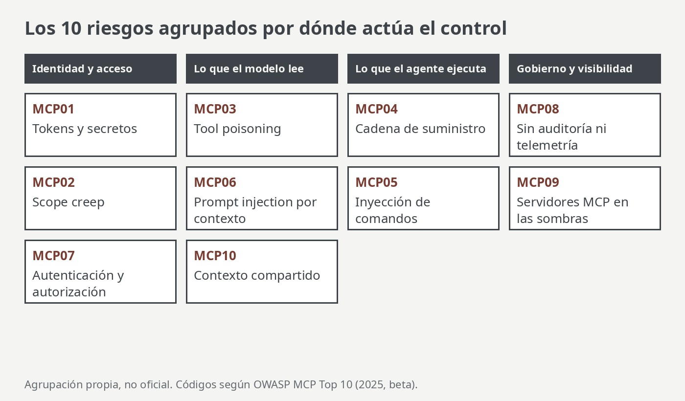

Un agente con MCP lee un ticket, llama a una API, ejecuta un comando y conserva contexto entre sesiones. Cada una de esas capacidades es una superficie de ataque que no existe cuando se evalúa solo el modelo. El proyecto **OWASP MCP Top 10** ordena esos riesgos en diez categorías. Este post las recorre y las agrupa por el lugar donde conviene poner el control.

Partí de un [post de LinkedIn de Mahesh Mallikarjunaiah](https://www.linkedin.com/posts/maheshma_aisecurity-mcp-owasp-share-7526094046751236096-GVMv/) que resume la lista, y lo contrasté con la [página oficial del proyecto](https://owasp.org/www-project-mcp-top-10/). La lista y las descripciones son de ellos; la agrupación y los comentarios son míos.

## Una corrección antes de empezar

En el post original, el riesgo 6 aparece como «Intent Flow Subversion». En la página oficial del proyecto el título es **«Prompt Injection via Contextual Payloads»**. «Intent Flow Subversion» aparece solo como nombre del archivo en el repositorio. Los otros nueve títulos coinciden. Conviene citar el título oficial si lo vas a usar en un documento de gobernanza.

También conviene saber que el proyecto está en **fase beta** (Phase 3, prueba piloto), con identificadores «2025» y sin número de versión publicado. La lista puede cambiar.

## Los diez riesgos, agrupados

### Identidad y acceso

| Código | Riesgo | Idea central |
|---|---|---|
| MCP01 | Token Mismanagement & Secret Exposure | Credenciales fijas en el código, tokens de larga vida o secretos que quedan en la memoria del modelo o en los logs |
| MCP02 | Privilege Escalation via Scope Creep | Permisos temporales que crecen con el tiempo hasta darle al agente más capacidad de la necesaria |
| MCP07 | Insufficient Authentication & Authorization | Servidores, herramientas o agentes que no verifican identidades ni aplican controles de acceso |

**Control típico:** credenciales de vida corta, permisos acotados a la tarea y autorización que se aplica fuera del modelo, en cada invocación.

### Lo que el modelo lee

| Código | Riesgo | Idea central |
|---|---|---|
| MCP03 | Tool Poisoning | Herramientas, plugins o sus salidas comprometidos que inyectan contexto engañoso |
| MCP06 | Prompt Injection via Contextual Payloads | Texto malicioso dentro del contexto recuperado que el modelo interpreta como instrucción |
| MCP10 | Context Injection & Over-Sharing | Contexto compartido o persistente que expone datos de una tarea o usuario a otro |

**Control típico:** tratar todo lo que devuelve una herramienta como **dato no confiable** y no como instrucción, validar entradas y salidas, y acotar la ventana de contexto por tarea, usuario y agente.

### Lo que el agente ejecuta

| Código | Riesgo | Idea central |
|---|---|---|
| MCP04 | Software Supply Chain Attacks & Dependency Tampering | Una dependencia comprometida cambia el comportamiento del agente o agrega una puerta trasera |
| MCP05 | Command Injection & Execution | El agente arma comandos, scripts o llamadas a partir de entrada no validada |

**Control típico:** fijar y verificar dependencias, ejecutar en entornos aislados (*sandbox*) y no construir comandos a partir de texto sin validar.

### Gobierno y visibilidad

| Código | Riesgo | Idea central |
|---|---|---|
| MCP08 | Lack of Audit and Telemetry | Sin registros no se puede reconstruir qué herramienta se invocó, con qué contexto ni por quién |
| MCP09 | Shadow MCP Servers | Despliegues de MCP sin aprobación, a menudo con credenciales por defecto o configuraciones permisivas |

**Control típico:** inventario de servidores MCP, registros de auditoría que no se puedan alterar y alertas sobre despliegues no aprobados.

## Lo que sí cambia respecto de evaluar el modelo

Muchos equipos de seguridad evalúan los LLM por toxicidad y alucinación. Un sistema con MCP agrega otra clase de pruebas: ¿qué pasa si una herramienta miente?, ¿si el contexto trae una instrucción oculta?, ¿si el agente acumula permisos con el tiempo? Esas preguntas no se contestan mirando solo al modelo.

La idea que más me parece que une a la lista es esta: **un guardarraíl dentro del prompt no es una frontera de seguridad.** Lo que decide si una acción se permite tiene que ejecutarse fuera del modelo, con identidad verificable y permisos mínimos, igual que en cualquier otro sistema distribuido.

## Una lista de acciones para empezar

1. Inventariar todos los servidores MCP, incluidos los que armó alguien «para probar».
2. Asignar a cada agente una identidad propia y permisos mínimos revisados periódicamente.
3. Usar tokens de vida corta y no dejar secretos en el código ni en el contexto.
4. Validar lo que entra y lo que sale de cada herramienta.
5. Registrar cada invocación con su contexto, en un almacén de solo escritura.
6. Separar el contexto por tarea, usuario y agente.
7. Exigir aprobación humana antes de acciones irreversibles.

## Qué es opinión y qué no

- Los diez títulos y la fase beta salen de la página oficial del proyecto, que leí para este post. Las descripciones cortas las parafraseo de ella y del post de LinkedIn; no revisé el texto completo de cada riesgo en el repositorio.
- **La agrupación en cuatro familias y los «controles típicos» son mi lectura**, no forman parte del documento de OWASP.
- La lista de siete acciones es una síntesis de prácticas habituales, no un procedimiento verificado en un sistema real. No probé estos controles contra un servidor MCP concreto.
- La infografía del post original no se reproduce aquí: la figura de este artículo es propia.
- Al ser un proyecto en beta, los códigos y títulos pueden cambiar antes de la versión final.
